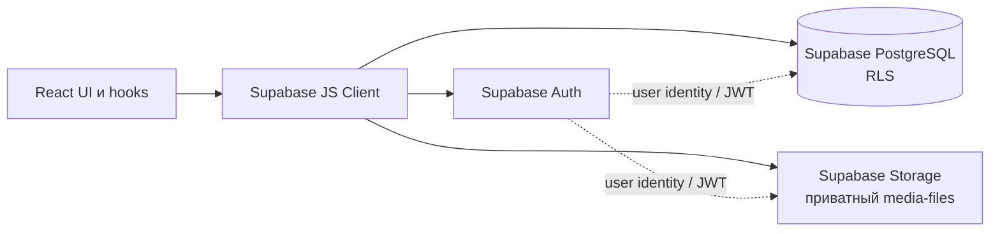

# Backend и интеграция с Frontend

## 1. Область и архитектура

Приложение хранит медиаданные пользователя: PostgreSQL содержит метаданные файлов и коллекции, а бинарные файлы находятся в Supabase Storage. Supabase Auth выдаёт и поддерживает пользовательскую сессию. React-клиент вызывает Supabase JavaScript Client непосредственно из браузера.

В репозитории нет собственного REST-сервера, собственных REST endpoints, Edge Functions или серверных обработчиков. Supabase предоставляет клиенту свои API для Auth, PostgreSQL (через PostgREST) и Storage; это не собственный API приложения.



Типичный путь запроса:

1. Пользователь действует в React-интерфейсе.
2. Компонент или hook вызывает функцию из `mediaApi.ts`, либо `supabase.auth`.
3. Supabase JS Client направляет запрос к Auth, PostgreSQL API или Storage с текущей пользовательской сессией.
4. RLS-политики PostgreSQL и Storage проверяют пользователя и владельца данных.
5. Результат или ошибка возвращается клиенту; hooks обновляют локальное состояние, а компоненты показывают данные, загрузку или сообщение об ошибке.

Расположение основных файлов:

- Supabase Client — [supabaseClient.ts](./frontend/src/shared/api/supabaseClient.ts).
- Клиентский слой работы с данными — [mediaApi.ts](./frontend/src/entities/media/api/mediaApi.ts).
- Типы интерфейса — [media.ts](./frontend/src/types/media.ts).
- Инициализация и состояние Auth — [App.tsx](./frontend/src/App.tsx).
- Форма входа и регистрации — [AuthPanel.tsx](./frontend/src/features/auth/AuthPanel.tsx).
- Hooks данных — `frontend/src/features/media/`.
- Схема, политики и bucket — [SQL-миграция](./supabase/migrations/20261015_000001_create_media_storage_schema.sql).

## 2. База данных

Подробные определения ниже подтверждаются миграцией в репозитории. Фактическое состояние удалённого проекта Supabase отдельно не проверялось; перед эксплуатацией нужно сверить применённую схему с миграцией.

### Тип `public.media_type`

Перечисление со значениями `image`, `video`, `audio`.

### `public.media_items`

Метаданные одного медиафайла.

| Поле | Тип | Ограничения и назначение |
|---|---|---|
| `id` | `uuid` | Первичный ключ, `NOT NULL`, `DEFAULT gen_random_uuid()` |
| `owner_id` | `uuid` | `NOT NULL`, `DEFAULT auth.uid()`, внешний ключ на `auth.users(id) ON DELETE CASCADE`; владелец строки |
| `title` | `text` | `NOT NULL`; `media_items_title_not_empty` запрещает пустое после `trim` значение |
| `type` | `public.media_type` | `NOT NULL`; только `image`, `video` или `audio` |
| `size` | `bigint` | `NOT NULL`, `CHECK (size >= 0)`; размер в байтах |
| `file_path` | `text` | `NOT NULL`, `UNIQUE`; не пустой; первый сегмент пути должен совпадать с `owner_id` |
| `preview_path` | `text` | Допускает `NULL`; если задан, должен быть непустым и начинаться с `owner_id/` |
| `duration_seconds` | `integer` | Допускает `NULL`; если задано, значение неотрицательное |
| `tags` | `text[]` | `NOT NULL`, `DEFAULT '{}'` |
| `created_at` | `timestamptz` | `NOT NULL`, `DEFAULT now()` |

`owner_id` используется для привязки записи к Auth-пользователю и изоляции строк политиками RLS. `file_path` — путь оригинала в Storage, а `preview_path` — необязательный путь превью, не URL. Для аудио текущий API использует `file_path`; для изображений и видео — `preview_path`, если он задан, иначе `file_path`. Генерация превью в коде не реализована.

### `public.collections`

Пользовательские подборки медиафайлов.

| Поле | Тип | Ограничения и назначение |
|---|---|---|
| `id` | `uuid` | Первичный ключ, `NOT NULL`, `DEFAULT gen_random_uuid()` |
| `owner_id` | `uuid` | `NOT NULL`, `DEFAULT auth.uid()`, FK на `auth.users(id) ON DELETE CASCADE` |
| `name` | `text` | `NOT NULL`; `collections_name_not_empty` запрещает пустое после `trim` значение |
| `description` | `text` | `NOT NULL`, `DEFAULT ''` |
| `created_at` | `timestamptz` | `NOT NULL`, `DEFAULT now()` |

### `public.collection_items`

Связующая таблица для связи многие-ко-многим между коллекциями и медиафайлами. Пара `(collection_id, media_item_id)` — составной первичный ключ, поэтому повторная связь запрещена.

| Поле | Тип | Ограничения и назначение |
|---|---|---|
| `collection_id` | `uuid` | `NOT NULL`, FK на `collections(id) ON DELETE CASCADE` |
| `media_item_id` | `uuid` | `NOT NULL`, FK на `media_items(id) ON DELETE CASCADE` |
| `created_at` | `timestamptz` | `NOT NULL`, `DEFAULT now()` |

Удаление коллекции или строки медиа удаляет связанные строки из `collection_items`. Удаление пользователя каскадно удаляет его строки в `media_items` и `collections`; для Storage-объектов такой каскад внешним ключом не предусмотрен.

### Индексы из миграции

- `media_items`: `(owner_id, created_at DESC)`, `(owner_id, type, created_at DESC)`, `(owner_id, title)`, GIN по `tags`.
- `collections`: `(owner_id, created_at DESC)`, `(owner_id, name)`.
- `collection_items`: отдельный индекс по `media_item_id`; индекс по `collection_id` обеспечивается составным первичным ключом.

## 3. Авторизация и безопасность

### Поток Auth

- Регистрация: `AuthPanel` вызывает `supabase.auth.signUp({ email, password })`. При успехе интерфейс сообщает, что при необходимости следует проверить почту; подтверждение почты зависит от настроек Supabase Auth.
- Вход: `supabase.auth.signInWithPassword({ email, password })`.
- Получение/восстановление сессии: `App` подписывается на `onAuthStateChange` и вызывает `getSession()`. Ошибка чтения сессии отображается в форме входа.
- Сессия сохраняется и обновляется клиентом Supabase: `persistSession: true`, `autoRefreshToken: true`, `detectSessionInUrl: true`.
- Выход: `supabase.auth.signOut()`; ошибка показывается пользователю.
- Загрузка файла дополнительно вызывает `supabase.auth.getUser()` и требует текущего пользователя.

После проверки сессии интерфейс показывает рабочее приложение только при наличии сессии; иначе открывает `AuthPanel`. Все запросы данных подразумевают пользовательскую авторизацию, а окончательную защиту обеспечивают серверные RLS-политики, а не скрытие UI.

### RLS в SQL-миграции

Миграция включает RLS для трёх таблиц:

- `media_items`: `SELECT`, `UPDATE`, `DELETE` разрешены только для строк `owner_id = auth.uid()`; `INSERT` требует такой же `owner_id`; `UPDATE` проверяет его и до, и после изменения.
- `collections`: аналогичные политики владения для `SELECT`, `INSERT`, `UPDATE`, `DELETE`.
- `collection_items`: `SELECT` и `DELETE` требуют принадлежности коллекции текущему пользователю; `INSERT` проверяет владение и коллекцией, и медиафайлом. Политики `UPDATE` для связей миграция не создаёт.

### Ключи и ручная проверка

Frontend читает только `VITE_SUPABASE_URL` и `VITE_SUPABASE_PUBLISHABLE_KEY`. Publishable/anon key предназначен для публичного клиента и сам по себе не предоставляет обход RLS; защита зависит от корректных политик. Секретный `service_role` либо иной привилегированный ключ нельзя включать в клиентский bundle: он доступен пользователю приложения и обходит обычную модель защиты.

По исходникам можно подтвердить содержимое миграции, но нельзя подтвердить, применена ли она к целевому проекту и нет ли в Supabase дополнительных или отличающихся политик. В Dashboard проверьте схему, RLS-флаги и политики всех таблиц, Storage policies, Auth Email provider и настройки подтверждения email.

## 4. Файловое хранилище

- Bucket в миграции называется `media-files`; он создаётся как приватный (`public = false`).
- Код и SQL используют путь `<user-uuid>/<object-name>`. Имя объекта создаётся как `<auth.uid()>/<crypto.randomUUID()><исходное расширение>`.
- Виджет очереди принимает изображение, видео или аудио по MIME-префиксу или распознанному расширению; ограничивает размер файла 50 MiB и отклоняет пустые файлы. `uploadMediaFile` повторно проверяет MIME-префикс и размер, но не имеет отдельного whitelist расширений.
- Этот лимит проверяется frontend-кодом. Миграция не задаёт ограничение размера bucket или его `allowed_mime_types`; серверный лимит и список MIME необходимо проверить/настроить в Supabase отдельно. Некоторые файлы, распознанные очередью только по расширению без соответствующего MIME, будут отклонены при загрузке.
- `uploadMediaFile` сначала отправляет объект в Storage (`upsert: false`), затем добавляет строку в `media_items`; поля `preview_path` и `duration_seconds` записываются как `null`, `tags` как пустой массив.
- `getMediaItems` формирует временный подписанный URL на 3600 секунд: для аудио — оригинал, для изображения/видео — превью при наличии, иначе оригинал. Это не публичные URL. Просроченные ссылки будут создаваться заново при повторном запросе списка.
- Удаление медиа сначала удаляет оригинал и возможное превью из Storage, затем строку PostgreSQL. Связи в коллекциях удаляются каскадно при удалении строки.

При сбое вставки метаданных после успешной загрузки клиент пытается удалить объект. Если эта очистка тоже завершается ошибкой, ошибка только записывается в `console.error`, и в Storage может остаться сиротский объект. При успешном удалении объекта и ошибке удаления строки API явно сообщает, что строка осталась; её ссылка может стать недействительной. Эти операции не являются транзакцией. При сетевом разрыве с неопределённым результатом запроса также возможна ручная проверка состояния в Storage и БД.

## 5. Публичные функции API-слоя

API расположен в [mediaApi.ts](./frontend/src/entities/media/api/mediaApi.ts). Это клиентские функции, а не HTTP endpoints приложения. Операции к таблицам проходят через Supabase JS Client, Storage-операции — через Storage API.

| Функция | Назначение | Входные параметры | Возвращаемое значение | Таблицы / Storage | Возможные ошибки |
|---|---|---|---|---|---|
| `getMediaItems()` | Получить медиатеку и подписанные URL | Нет | `Promise<MediaItem[]>` | `media_items`, bucket `media-files` | Ошибка запроса метаданных; если создание signed URL не удалось, ошибка лишь логируется, а элемент возвращается с пустым `previewUrl` |
| `mediaApi.updateMediaTitle(mediaId, title)` | Переименовать запись | `mediaId: string`, `title: string` | `Promise<void>` | `media_items` | Пустое название, ошибка БД/RLS, запись не найдена или недоступна |
| `mediaApi.deleteMediaItem(mediaId)` | Удалить объект(ы), затем метаданные | `mediaId: string` | `Promise<void>` | `media_items`, bucket `media-files`; каскад к `collection_items` | Ошибка чтения, Storage или БД/RLS; при сбое второго шага специально сообщается о частичном удалении |
| `mediaApi.getCollections()` | Получить коллекции с ID входящих файлов | Нет | `Promise<MediaCollection[]>` | `collections`, вложенное чтение `collection_items` | Ошибка запроса БД/RLS |
| `mediaApi.createCollection(payload)` | Создать коллекцию | `CreateCollectionPayload`: `name: string`, `description?: string` | `Promise<MediaCollection>` | `collections` | Пустое название, ошибка БД/RLS |
| `mediaApi.addMediaToCollection(collectionId, mediaId)` | Добавить файл в коллекцию и перечитать её | Оба параметра `string` | `Promise<MediaCollection>` | `collection_items`, `collections` | Ошибка БД/RLS, дубликат (`23505`); связь может быть добавлена, даже если последующее чтение коллекции завершилось ошибкой |
| `mediaApi.removeMediaFromCollection(collectionId, mediaId)` | Удалить связь, не удаляя файл | Оба параметра `string` | `Promise<MediaCollection>` | `collection_items`, `collections` | Ошибка БД/RLS, отсутствующая/недоступная связь; ошибка перечитывания после удаления |
| `mediaApi.deleteCollection(collectionId)` | Удалить коллекцию | `collectionId: string` | `Promise<void>` | `collections`; каскадно `collection_items` | Ошибка БД/RLS, коллекция отсутствует или недоступна |
| `mediaApi.getStorageSummary()` | Рассчитать сводку использования для UI | Нет | `Promise<StorageSummary>`: `usedGb`, `totalGb`, `freeGb`, `percentage` | `media_items.size` | Ошибка чтения БД/RLS |
| `mediaApi.getLibrarySummary()` | Получить количество файлов и дату самой новой записи | Нет | `Promise<{ totalFiles: number; updatedAt: string }>` | `media_items.created_at` | Ошибка запроса БД/RLS |
| `uploadMediaFile(file)` | Загрузить файл и записать метаданные | `file: File` | `Promise<void>` | Auth `getUser()`, bucket `media-files`, `media_items` | Нет/просроченная сессия, ошибки сети Auth (часть текстов классифицируется), неподдерживаемый MIME, пустой/слишком большой файл, ошибки Storage/БД; ошибка очистки объекта после сбоя БД только логируется |

`getStorageSummary()` суммирует поле `size` для доступных пользователю строк и сравнивает сумму с фиксированным `totalGb = 1`. Это временная квота отображения, не фактическая квота Supabase и не запрос Storage usage API. `getLibrarySummary()` рассчитывает количество из загруженных строк и форматирует дату создания самой новой записи, а не дату последнего обновления; функция API и hook `useLibrarySummary` существуют, но текущий `App` этот hook не использует.

## 6. Интеграция Frontend с Backend

`App.tsx` восстанавливает сессию, подписывается на Auth state и только после этого монтирует пользовательские страницы. `useMediaLibrary` загружает и хранит список, состояние загрузки и ошибку; после переименования или удаления обновляет локальные элементы. `useMediaCollections` аналогично меняет состояние после успешных операций с коллекциями. `useStorageSummary` запрашивает данные при монтировании; `useLibrarySummary` реализован отдельно, но не используется текущим `App`.

Страница библиотеки использует `LibraryPage` для представления карточек, а `LibraryOverviewPage` показывает выбранное медиа, коллекции и реальный виджет `UploadFilesCard`. После одной или нескольких успешных загрузок виджет вызывает callback обновления библиотеки. Коллекции отображаются через `CollectionsPage` и боковую/обзорную часть интерфейса. Маршрут `/upload` сейчас — статическая заглушка и реальную загрузку не выполняет.

Пример клиента (URL и ключ проверяются при инициализации):

```ts
export const supabase = createClient(supabaseUrl, supabasePublishableKey, {
  auth: {
    persistSession: true,
    autoRefreshToken: true,
    detectSessionInUrl: true,
  },
})
```

Пример синхронизации интерфейса с Auth state:

```ts
supabase.auth.onAuthStateChange((_event, newSession) => {
  setSession(newSession)
  setSessionLoading(false)
})
```

Hooks отражают `loading` и `error` отдельно от данных. Библиотека показывает ошибку и действие повтора; операции переименования/удаления показывают результат через сообщение; форма Auth показывает ошибки и сообщение о регистрации. Некоторые страницы не показывают `loading`/`error` своих hooks напрямую, что отмечено ниже.

## 7. Обработка ошибок и оставшиеся пробелы

Подтверждённая обработка:

- Общий модуль `frontend/src/shared/lib/logger.ts` пишет JSON-записи в консоль браузера с timestamp ISO 8601, уровнем, сообщением и безопасным контекстом. `info` подавляется в production; предупреждения и ошибки остаются.
- Логируются Auth-вход/регистрация/выход и сбои восстановления сессии; загрузка/получение/переименование/удаление медиа; операции коллекций и сводок; ошибки Supabase-запросов и ошибки очистки после частичной загрузки.
- Точка входа регистрирует необработанные JavaScript-ошибки и отклонённые Promise. `AppErrorBoundary` фиксирует ошибки React render и показывает fallback вместо пустого экрана.
- Логгер исключает контекстные поля, похожие на credentials, email, пути и содержимое, а также маскирует распространённые форматы токенов, email, URL и путей. В события не передаются пароли, file contents, имена файлов, заголовки или Auth-сессии. Логи не покидают браузер.
- Ошибка начального `getSession()` или исключение запроса приводит к состоянию без сессии и отображается на AuthPanel.
- Ошибки `signInWithPassword`, `signUp`, `signOut` перехватываются и отображаются в UI.
- Ошибки запросов медиатеки, коллекций и сводок сохраняются в hooks; для списка медиа предусмотрена кнопка повтора.
- API-функции проверяют ошибки Supabase и в большинстве операций выбрасывают сообщения с контекстом. Обрабатываются пустые названия, дубликат связи, отсутствующие записи/связи.
- Очередь загрузки показывает статусы по файлам, текст ошибок и позволяет повторить неудачные загрузки.
- В `uploadMediaFile` часть ошибок `getUser()` по тексту классифицируется как сеть или истечение сессии; отсутствие пользователя и неподдерживаемый MIME/размер также имеют отдельные сообщения.
- При ошибке создания signed URL в списке медиа пишется `console.error`; операция не прерывает список и показывает пустой `previewUrl`.
- Ошибки очистки сиротского объекта после неудачной вставки метаданных только логируются, не показываются как отдельное второе сообщение.

Не реализовано или не покрыто подтверждённой обработкой:

- Нет общего механизма offline/retry для сетевых ошибок; классификация ошибок Auth основана на совпадениях в тексте и применяется только в upload-функции.
- Ошибки PostgreSQL/RLS обычно показываются как сообщения Supabase; отдельной классификации запрета доступа нет.
- Логи доступны только в консоли браузера и не сохраняются централизованно; маскирование снижает риск утечки, но сообщения ошибок стороннего сервиса остаются текстовыми данными и требуют осторожности при диагностике.
- При ошибке загрузки списка коллекций/сводки hooks сохраняют `error`, но текущая интеграция `App` не передаёт эти состояния для видимого сообщения в UI.
- Частичные операции (upload + insert, Storage delete + DB delete, изменение связи + перечитывание) не атомарны.
- Не выполняется фоновая сверка сиротских объектов и записей.
- Реальный лимит Storage, допустимые MIME types, фактическое состояние политики в целевом проекте и настройки Auth требуют проверки в Supabase.

## 8. Настройка и запуск

### Предварительные требования

Нужны Node.js/npm, доступ к проекту Supabase и настроенный Email provider. Версии Node.js/npm в `package.json` не закреплены.

### Установка и frontend-конфигурация

Из корня репозитория:

```bash
cd frontend
npm ci
cp .env.example .env.local
```

Заполните `VITE_SUPABASE_URL` и `VITE_SUPABASE_PUBLISHABLE_KEY` значениями из Dashboard Supabase (настройки API проекта). Реальные локальные `.env` не включайте в документацию или репозиторий.

В [frontend/.env.example](./frontend/.env.example) уже перечислены ровно эти две переменные; их отсутствие приводит к явной ошибке при инициализации клиента.

### База и Storage

1. Создайте/выберите Supabase-проект и убедитесь, что включён Email provider.
2. Проверьте текущие таблицы, политики и объекты, чтобы не перезаписать существующие настройки.
3. Просмотрите [миграцию](./supabase/migrations/20261015_000001_create_media_storage_schema.sql) и примените её выбранным способом (например, SQL Editor Dashboard или настроенный Supabase CLI).
4. В Supabase Dashboard проверьте приватность bucket `media-files`, политики Storage и фактические ограничения файла. Миграция не задаёт серверные ограничения по размеру/MIME.
5. Проверьте изолированность данных двух тестовых пользователей и доступ по подписанным URL.

В репозитории не найден `supabase/config.toml`; миграция автоматически не применяется при `npm`-командах. Не применяйте её к удалённому проекту без предварительного обзора.

### Команды из `frontend/package.json`

```bash
npm run dev
npm run lint
npm run build
npm run preview
npm run test
```

Здесь перечислены существующие команды; отдельной команды backend-сервера или применения миграции в `package.json` нет.

### Типовые проблемы конфигурации

- Не заданы env-переменные: Supabase Client завершает инициализацию с явной ошибкой.
- URL или ключ от другого Supabase-проекта: Auth и запросы ведут не в целевой проект.
- Миграция не применена/отличается: запросы таблиц или bucket завершаются ошибкой.
- RLS/Storage policies не настроены: операции запрещаются даже при корректном ключе.
- Не включён Email provider или включено подтверждение email: поведение регистрации зависит от настроек Supabase.
- Файл превышает клиентский лимит 50 MiB или имеет неподдерживаемый MIME: загрузчик отклонит его до Storage.
- Истёкшая подписанная ссылка требует повторного запроса списка медиа.

## 9. Ограничения и дальнейшее развитие

### Подтверждённые текущие ограничения

- Прямой доступ браузера к Supabase; собственного серверного уровня, Edge Functions и серверной валидации в коде нет.
- Превью-файлы не создаются, `preview_path` при загрузке остаётся `null`; `duration_seconds` также не извлекается.
- Размер и тип файла валидируются на клиенте; серверный лимит/whitelist bucket не определён в SQL-миграции.
- Квота 1 GiB является константой UI, а не реальным лимитом.
- Подписанные URL действуют 3600 секунд.
- UI-маршрут `/upload` заглушка; реальный uploader находится в обзоре библиотеки.
- Поддержка сортировки/поиска по БД, пагинации и автоматической очистки Storage объектов не реализована.
- Миграция есть в репозитории, но применение к удалённому Supabase не подтверждено.

### Возможные улучшения

- Установить серверные лимиты размера и MIME в Storage, согласованные с интерфейсом.
- Организовать серверный процесс генерации превью и чтения длительности, если это требуется продукту.
- Добавить согласованную очистку/восстановление для частично выполненных Storage и SQL операций.
- Загружать медиатеку с пагинацией, а сводки получать агрегированным запросом.
- Синхронизировать экран `/upload` с реально работающим загрузчиком.
- Добавить интеграционные проверки RLS, Storage policies и Auth на отдельном тестовом Supabase-проекте.

## 10. Проверка по Supabase перед эксплуатацией

В удалённом проекте необходимо вручную подтвердить:

1. Применённость миграции и совпадение фактических типов, ограничений, индексов и внешних ключей.
2. RLS включён на `media_items`, `collections`, `collection_items`, а активные политики соответствуют миграции.
3. Bucket `media-files` существует и приватен; Storage policies ограничивают операции объектами с префиксом собственного UUID.
4. Заданы приемлемые серверные лимиты файла и правила MIME — SQL их не устанавливает.
5. Auth Email provider, подтверждение email и redirect URL соответствуют ожидаемому пользовательскому потоку.
6. Конфигурация frontend содержит URL и publishable key именно этого проекта и не содержит `service_role`.
